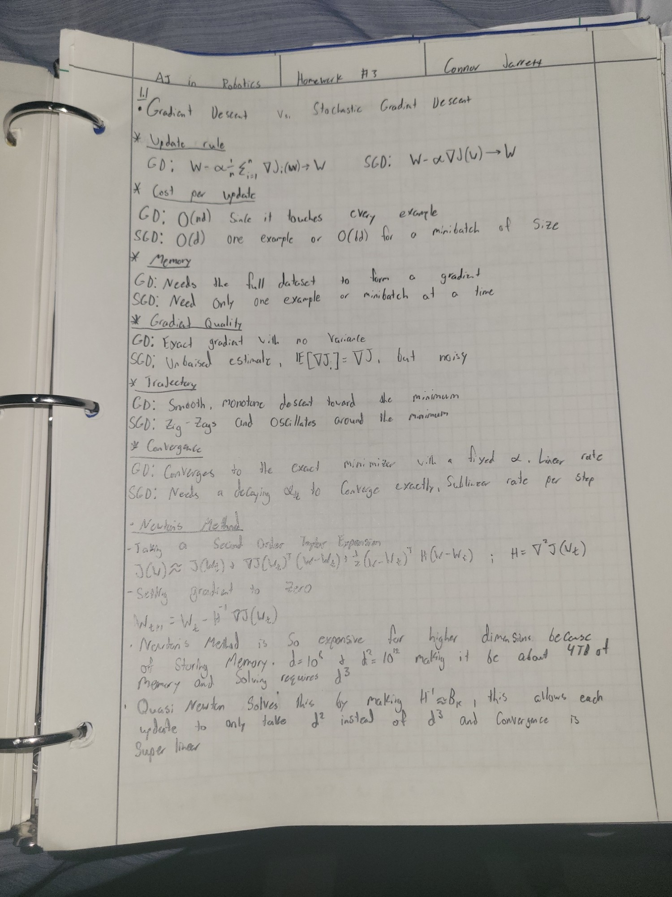
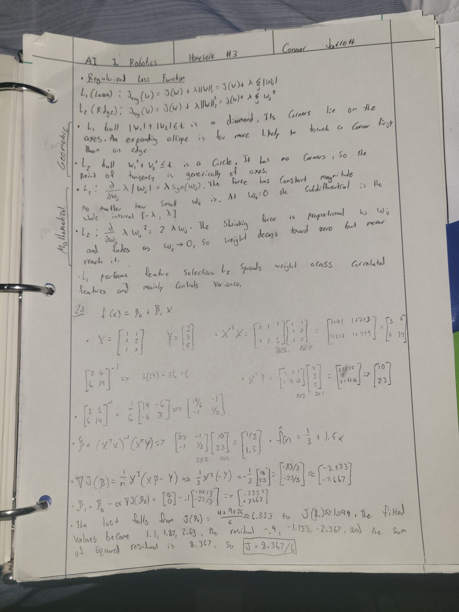

# Homework 3 — AI in Robotics (ENGR 6010-01)

**Student:** Connor Jarrett
**Professor:** Hongbo Zhang
**Date:** 10/16/2026

## Contents

| Item | Location |
| --- | --- |
| 📄 Code report (Problem 3.1 write-up) | [`report/Homework_3_Code_Report.pdf`](report/Homework_3_Code_Report.pdf) |
| 🐍 Classifier benchmark code | [`code/classifier_benchmark.py`](code/classifier_benchmark.py) |
| ✍️ Handwritten work, page 1 | [`written_work/page_1.jpg`](written_work/page_1.jpg) |
| ✍️ Handwritten work, page 2 | [`written_work/page_2.jpg`](written_work/page_2.jpg) |

---

## Written Work

### Page 1 — Problem 1.1: Gradient Descent vs. SGD, Newton's Method, Quasi-Newton



### Page 2 — Regularized Loss Functions (L1 vs. L2) and Problem 2.1: Linear Regression



---

## Code Report

The full report explaining the program and its results is here:
**[Homework_3_Code_Report.pdf](report/Homework_3_Code_Report.pdf)**

### Problem 3.1 — Supervised Classifier Comparison (Iris)

[`code/classifier_benchmark.py`](code/classifier_benchmark.py) trains five classifiers on the Iris
dataset (70/30 train/test split, `random_state=42`) and reports macro-averaged
Accuracy, Precision, Recall, and F1-Score on the 45-flower test set:

- Logistic Regression
- K-Nearest Neighbors (K = 5)
- SVM (RBF kernel)
- Random Forest (100 trees)
- Gaussian Naive Bayes

### How to run

```bash
pip install -r requirements.txt
python code/classifier_benchmark.py
```

### Results

| Model | Accuracy | Precision | Recall | F1-Score |
| --- | --- | --- | --- | --- |
| Logistic Regression | 1.0000 | 1.0000 | 1.0000 | 1.0000 |
| KNN (K=5) | 1.0000 | 1.0000 | 1.0000 | 1.0000 |
| SVM (RBF) | 1.0000 | 1.0000 | 1.0000 | 1.0000 |
| Random Forest | 1.0000 | 1.0000 | 1.0000 | 1.0000 |
| Gaussian Naive Bayes | 0.9778 | 0.9762 | 0.9744 | 0.9743 |

Four models classified all 45 test flowers correctly. Gaussian Naive Bayes misclassified one
versicolor as virginica, which comes from its feature-independence assumption (petal length
and width are strongly correlated). See the [report](report/Homework_3_Code_Report.pdf) for the
full discussion.
