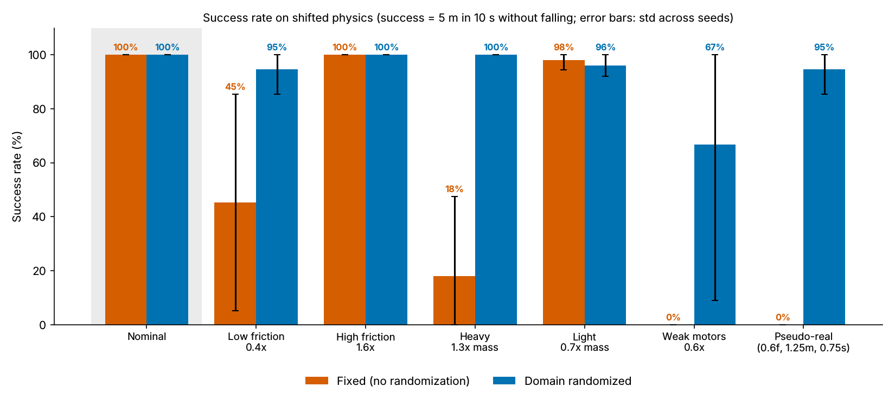
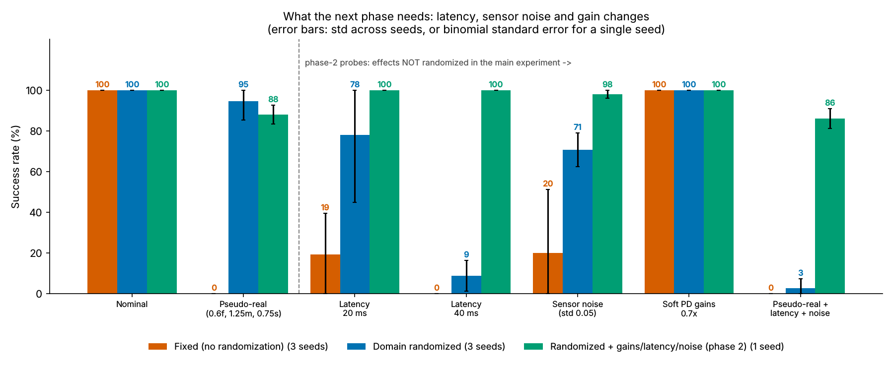

# Domain Randomization Experiment

ENGR 6010 (AI in Robotics), Readings 5

This project shows how **domain randomization** shrinks the **sim-to-real gap** for a
learned walking controller:

1. Train a PPO walking controller on a **fixed** simulator (nominal physics).
2. Train a second controller the same way, but with **domain randomization**: friction,
   link mass and motor strength are re-sampled at every episode reset.
3. Test both controllers on simulators whose friction, mass and motor strength have been
   **changed**. These stand in for "the real robot", so the drop in performance is a stand-in
   for the sim-to-real gap.
4. Compare success rates in a bar chart.

Everything runs on **Windows 10/11 in VS Code** with plain `pip` packages. You don't need
Linux, WSL, Docker, or a compiler.

The folder already contains **trained models**: 3 seeds each of `fixed` and `randomized`, plus
one phase-2 `randomized_plus` model, in `runs/`. It also contains the **results from my run** in
`results/`, including plots, CSVs, robot pictures and GIFs. So `watch.py`, `plot_results.py` and
the phase-2 demo work right away without retraining.

**Phase 2:** the same code is set up as a starting point for a follow-on project on a real
quadruped. It has extra sim-to-real effects (latency, sensor noise, gain randomization), a
numpy-only policy export, and a robot interface with a deployment loop. See the
[Phase 2 section](#phase-2-using-this-for-the-next-project) and [`docs/phase2.md`](docs/phase2.md).

---

## The robot and the controller

* `envs/robot.xml` is my own MJCF model. It is a **planar two-legged "bounding" robot**,
  essentially a 2D slice through a quadruped. It has a torso, a back leg and a front leg,
  and a hip and a knee on each leg, which gives 4 `motor` (torque) actuators. It weighs about 9.7 kg.
* The policy outputs **joint position targets** at 50 Hz. A **PD controller in Python**
  turns those targets into torques at every 5 ms physics substep:
  `tau = clip(s * (kp*(q_target - q) - kd*qdot), -s*tau_max, +s*tau_max)`.
  Here `s` is the **motor strength scale**, which scales both the PD output and the torque limit.
  This is the setup used by Hwangbo et al. (2019) and by most of the policies in the
  Gurram et al. (2024) survey.
* **Reward** = `2 * min(vx, 1.0 m/s)` (forward progress toward the 1 m/s target speed)
  `+ 0.5` alive bonus `- 0.02 * torque^2` (normalized) `- 0.5 * pitch^2`.
  The episode **terminates** when the robot falls: the torso drops below 0.18 m or tilts more than 1 rad.
* **Physics config:** `friction_scale`, `mass_scale` (mass **and** inertia of every link)
  and `motor_strength_scale` are applied at reset. They are always applied to the **nominal
  values stored when the environment is created**, so the scaling never compounds.

### Domain randomization ranges (config.py)

| Parameter       | Randomized range |
|-----------------|------------------|
| Friction        | 0.5x to 1.5x     |
| Link mass       | 0.8x to 1.2x     |
| Motor strength  | 0.7x to 1.1x     |

### Definition of success

An episode is a **success** if the robot's torso travels **at least 5 m forward within the
10 s episode (500 steps) without falling**. At the 1 m/s target speed a good gait covers about
9 to 10 m, so 5 m leaves room for a slow start but still requires real walking. I picked 5 m so
that the fixed-physics policy succeeds on nominal physics nearly every time (it did: see
the results below). Change `SUCCESS_DISTANCE` in `config.py` to make it stricter or looser.

### Test conditions ("the real robot")

| Condition      | Friction | Mass  | Motor | In training range? |
|----------------|----------|-------|-------|--------------------|
| nominal        | 1.0      | 1.0   | 1.0   | yes                |
| low_friction   | **0.4**  | 1.0   | 1.0   | no (below 0.5)     |
| high_friction  | **1.6**  | 1.0   | 1.0   | no (above 1.5)     |
| heavy          | 1.0      | **1.3** | 1.0 | no (above 1.2)     |
| light          | 1.0      | **0.7** | 1.0 | no (below 0.8)     |
| weak_motors    | 1.0      | 1.0   | **0.6** | no (below 0.7)   |
| pseudo_real    | 0.6      | 1.25  | 0.75  | partly (mass is outside) |

Every condition except nominal lies at least partly **outside** the randomization range on
purpose, so the test checks generalization and not just memorization. Every model sees the
**same 50 test episodes** for each condition (episode *i* always uses seed `12345 + i`).

---

## Step-by-step setup on Windows

### 1. Install Python 3.11
Download **Python 3.11** (64-bit) from <https://www.python.org/downloads/windows/>.
In the installer, **tick "Add python.exe to PATH"** before clicking *Install Now*.
Python 3.10 and 3.12 also work. Check the install in a terminal with `py -3.11 --version`.

### 2. Open the folder in VS Code
Unzip `domain_randomization_experiment.zip`, then in VS Code choose *File -> Open Folder...* and
pick `domain_randomization_experiment`. Install the **Python** extension from Microsoft
(Extensions panel, Ctrl+Shift+X).

### 3. Create the virtual environment and install packages
Open a terminal in VS Code (*Terminal -> New Terminal*). It is PowerShell by default. Run:

```powershell
py -3.11 -m venv .venv
.venv\Scripts\activate
pip install -r requirements.txt
```

If PowerShell says *"running scripts is disabled on this system"*, run this once and then activate again:

```powershell
Set-ExecutionPolicy -Scope CurrentUser RemoteSigned
```

Then press Ctrl+Shift+P, choose **Python: Select Interpreter**, and pick `.venv\Scripts\python.exe`.
The install downloads about 300 MB (mostly PyTorch) and takes 2 to 5 minutes.

### 4. Run the pipeline
You can run each step from the terminal (venv active), or from the **Run and Debug** panel
(Ctrl+Shift+D), which has ready-made configurations in `.vscode/launch.json`.

| Step | Command | VS Code config | Expected time (laptop CPU) |
|------|---------|----------------|----------------------------|
| a. Quick test | `python quick_test.py` | *1. Quick test* | 1 to 3 min |
| b. Train fixed | `python train.py --mode fixed` (3 seeds) | *2. Train fixed* | 30 to 60 min (10 to 20 per seed) |
| c. Train randomized | `python train.py --mode randomized` (3 seeds) | *3. Train randomized* | 30 to 60 min |
| d. Evaluate | `python evaluate.py` | *4. Evaluate + Plots* | 5 to 15 min (7 models) |
| e. Plot | `python plot_results.py` | (included in 4) / *9. Plots only* | under 10 s |
| f. Watch | `python watch.py --model fixed --condition low_friction` | *5. Watch* | real time |
| g. Pictures for slides | `python make_media.py` | *6. Make pictures + GIFs* | about 1 min |

My measured times on a 4-core cloud CPU: the quick test took about 1 min, and each 1.5 M-step
training run took about 10 to 12 min (I ran 4 at the same time). Evaluating all 7 models took a few
minutes. A typical laptop
should be similar or a bit slower. To save time, you can run *Train fixed* and *Train randomized* at
the same time in two terminals.

* **Quick test** runs `check_env`, trains both modes for 20 k steps, evaluates with 5 episodes and
  makes every plot. It writes to `runs_quick/` and `results_quick/`, so it **never overwrites** the
  real models and results.
* **Skip training:** the trained models are already included, so you can go straight to steps d to f.
  Retraining overwrites `runs/<mode>_seed<N>/`.
* **Seeds:** `python train.py --all` trains both modes for every seed in `config.DEFAULT_SEEDS`
  (`[0, 1, 2]`). `python train.py --mode fixed --seed 1 --timesteps 1500000` trains one specific
  run. The error bars in the plots show the standard deviation across seeds. With only one seed,
  they switch automatically to the binomial standard error.
* **One-click alternative:** double-click `run_all.bat`. It creates the venv, installs everything
  and runs the full pipeline, including all 7 training runs (about 1.5 to 2.5 hours).

### Watching the robot
```powershell
python watch.py --model fixed --condition low_friction
python watch.py --model randomized --condition low_friction
python watch.py --model fixed --condition pseudo_real --record   # save an MP4 instead
```
A MuJoCo viewer window opens with the camera following the robot. Each episode prints the
distance and whether the robot fell. Close the window to stop. With `--record` (or if the viewer
cannot open), an MP4 is saved to `results/videos/`.

**Why does the fixed controller fall on its face on low friction?** It slips first, and then it
loses its balance. Its first push slips: the back foot shoots backward at about 1.5 m/s instead of
driving the body forward. The bounding rhythm breaks, and the front leg ends up carrying the robot
alone while its foot creeps forward. The nose then drops until the torso is below 0.18 m, which
counts as a fall. All of this happens in about half a second. It never saw a slip in training, so it
has no learned correction. The randomized controller trained on friction as low as 0.5x and stays
level. `results/media/filmstrip_low_friction.png` shows both side by side.

---

## Phase 2: using this for the next project

[`docs/phase2.md`](docs/phase2.md) has the full plan. In short:

| Phase-2 tool | Command | What it shows |
|--------------|---------|---------------|
| Extra sim-to-real randomization | `python train.py --mode randomized_plus` | PD gains (0.8 to 1.2x), actuator latency (0 to 40 ms) and sensor noise, randomized together with friction, mass and motor strength |
| Probe tests | `python evaluate.py` (automatic) | Latency, sensor noise and soft gains, which the main experiment did not randomize, in `results/phase2_probes.png` |
| Policy export | `python export_policy.py` | Writes `runs/<run>/policy_export.npz` and checks that the numpy-only policy matches SB3 |
| Deployment loop | `python deploy_sim.py --run randomized_seed0 --condition pseudo_real` | The robot-side loop `read_state -> policy -> send(q, kp, kd)` at 50 Hz, the same shape as Unitree's LowState / LowCmd. It checks that the loop matches the training env exactly |
| Both at once | `python export_and_deploy.py` | VS Code config *8* |

The deployment code lives in `deploy/`:
- `numpy_policy.py` runs the policy with numpy only.
- `observation.py` builds the observation from what a robot can measure.
- `robot_interface.py` holds `RobotInterface`, the working MuJoCo `SimRobot`, and a `Go2Robot`
  template for `unitree_sdk2_python`. The template is untested: there was no robot or SDK here.

---

## My results (3 seeds per controller, 1.5 M timesteps each, 50 test episodes per condition and seed)

Success rate, as the mean over seeds:

| Condition     | Fixed | Randomized | Phase-2 `randomized_plus` (1 seed) |
|---------------|-------|------------|-------------------------------------|
| nominal       | 100%  | 100%       | 100% |
| low_friction  | 45%   | 95%        | 100% |
| high_friction | 100%  | 100%       | 100% |
| heavy         | 18%   | 100%       | 100% |
| light         | 98%   | 96%        | 100% |
| weak_motors   | 0%    | 67% (one seed failed) | 16% |
| pseudo_real   | 0%    | 95%        | 88% |
| **gap (nominal minus pseudo-real)** | **100 pts** | **5 pts** | 12 pts |
| *Probe:* latency 20 ms | 19% | 78% | 100% |
| *Probe:* latency 40 ms | 0%  | 9%  | 100% |
| *Probe:* sensor noise  | 20% | 71% | 98% |
| *Probe:* soft PD gains 0.7x | 100% | 100% | 100% |
| *Probe:* pseudo-real + latency + noise | 0% | 3% | 86% |

- **Training speed:** the randomized controller learned more slowly. It first averaged 5 m per
  episode at about 212 k steps, compared with about 150 k for fixed. It reached 95% of its final
  reward at about 440 k steps, compared with about 280 k. Both ended at about the same reward.
- **Weak motors:** this was the hardest shift. Two randomized seeds passed it 100% of the time and
  one failed it completely.
- **Probes:** these show that randomization only covers what you randomize.

See `docs/writeup.md` for the full discussion and `docs/phase2.md` for what the probes mean for the next phase.





---

## Output files

| File | What it is |
|------|------------|
| `runs/<mode>_seed<N>/model.zip` | trained PPO policy |
| `runs/<mode>_seed<N>/vecnormalize.pkl` | observation normalization statistics |
| `runs/<mode>_seed<N>/training_log.csv` | reward / distance during training |
| `results/eval_results.csv` | every test episode: model, seed, condition, success, distance, reward |
| `results/friction_sweep.csv` | every episode of the friction sweep |
| `results/summary.csv` | success rate, mean distance, fall rate per model and condition |
| `results/success_rate_bar.png` | **main figure**: grouped bar chart of success rate |
| `results/gap_summary.png` | success drop from nominal to pseudo-real for each controller |
| `results/friction_sweep.png` | success rate vs. friction scale 0.3x to 1.8x |
| `results/training_curves.png` | training reward and distance for both conditions |
| `results/phase2_probes.png` | latency / sensor-noise / gain probes, including the phase-2 controller |
| `results/media/` | robot picture, filmstrips (fixed vs. randomized) and GIFs, made by `make_media.py` |
| `runs/<run>/policy_export.npz` | numpy-only policy for deployment, made by `export_policy.py` |

## Project layout

```
domain_randomization_experiment/
  config.py               every setting (physics, PD gains, reward, ranges, PPO, tests)
  envs/robot.xml          MJCF model of the planar bounding robot
  envs/walker_env.py      Gymnasium environment (PD control, physics scaling, randomization)
  train.py                PPO training (--mode, --seed, --timesteps, --all, --quick)
  evaluate.py             test suite -> results/eval_results.csv, friction_sweep.csv
  plot_results.py         figures + summary table
  watch.py                live viewer (launch_passive) or MP4 recording
  quick_test.py           end-to-end smoke test (now also checks export + deployment loop)
  evaluate_and_plot.py    evaluate + plot in one go (VS Code config 4)
  make_media.py           robot pictures, filmstrips and GIFs for slides (offscreen)
  export_policy.py        phase 2: export a policy to numpy (+ equality check vs SB3)
  deploy_sim.py           phase 2: robot-side control loop with SimRobot
  export_and_deploy.py    phase 2: export + deployment demo in one go (VS Code config 8)
  deploy/                 numpy_policy.py, observation.py, robot_interface.py (SimRobot, Go2Robot)
  run_all.bat             one-click setup + full pipeline
  docs/writeup.md         Program Explanation + Results sections for the report
  docs/phase2.md          how this simulation carries into a phase-2 project
```

---

## Troubleshooting

**"running scripts is disabled on this system" when activating the venv**
Run `Set-ExecutionPolicy -Scope CurrentUser RemoteSigned` in PowerShell, then
`.venv\Scripts\activate` again. You can also switch the VS Code terminal to *Command Prompt*
and run `.venv\Scripts\activate.bat`.

**`py` is not recognized / wrong Python version**
Reinstall Python 3.11 from python.org with "Add to PATH" ticked, and also tick the "py launcher" option.
Do not use the Microsoft Store Python.

**pip errors (e.g. "No matching distribution found for torch==2.5.1")**
This almost always means the wrong Python version (3.13 or 32-bit). Check with `python --version`
inside the venv. Delete `.venv` and create it again with `py -3.11 -m venv .venv`. Running
`python -m pip install --upgrade pip` first also helps. If you are on a slow or corporate network,
run the install again; it resumes where it left off.

**The viewer window does not open, or you get OpenGL / GLFW errors**
`watch.py` automatically falls back to recording an MP4 in `results/videos/`. You can also
force it with `--record`. Update your graphics driver if you want the live viewer. Over
Remote Desktop, use `--record`.

**The MP4 is not created**
Make sure `imageio-ffmpeg` installed (`pip install imageio-ffmpeg==0.5.1`). If offscreen
rendering also fails, your GPU driver does not support OpenGL. Update the driver, or run
on another machine.

**Training is slow**
Close other programs, or train the two modes in two terminals at the same time. A lower budget
also works (`--timesteps 800000`), but the fixed policy may then walk less reliably.

**"No trained models found in runs/"**
Run `train.py` first, or make sure the included `runs/` folder was unzipped next to the scripts.
